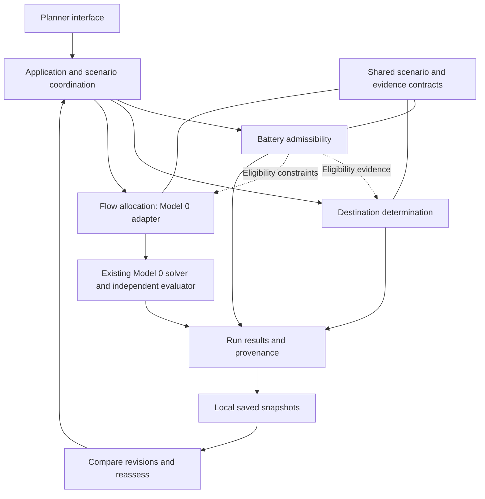

# Modular EV battery disposition DSS

Implementation date: 2026-10-22. This is a local modular monolith with three callable
capabilities, a shared scenario contract, and a Streamlit planner.

## Components and incremental mapping

| Responsibility | Location | Migration choice |
| --- | --- | --- |
| Existing domain/action/policy records | `dss/domain.py`, `allocation.py`, `policy.py` | Retain public APIs |
| Shared planning records | `dss/planning.py` | Add optional observations and separate pair assessments |
| Battery admissibility | `dss/admissibility.py` | Shared three-status service; Model 0's helper remains compatible |
| Destination determination | `dss/destination.py` | Independently callable comparisons and tied preferences |
| Flow allocation | `dss/flow.py` → `level0/` | Adapter; retain mathematical implementation and import paths |
| Scenario orchestration | `dss/application.py` | Four modes, run provenance and comparison |
| Scenario import/export | `dss/serialization.py` | Strict versioned JSON and seven-column CSV |
| Run repository | `dss/storage.py` | Append-only SQLite snapshots |
| Planner interface | `planner/app.py` | New shared interface |
| Existing research demonstration | `demo/` | Preserve independently |



Connections represent supported information use. Callers can supply eligibility
directly. Joint destination/quantity selection happens inside Model 0; advisory
rankings are not an optimiser input. No callback cycle or mandatory three-stage
pipeline is needed to express this interaction.

## Shared contract

`PlanningScenario` declares the actor, controllable actions, objective, horizon,
pack observations, destinations, resources, compatible-demand bounds, assessments,
deferral costs, assumptions and source. Scenario IDs and human version numbers
identify revisions; a SHA-256 fingerprint identifies the complete input snapshot.
Different inputs may share a human version number but never the same fingerprint.

The first release uses indivisible packs. A pack ID identifies the current
configuration; disassembly/regrouping and aggregate batch quantities require a
future configuration model. Every pair assessment specifies economic value,
avoided kg CO2e, pathway capacity use and resource consumption. Pair resource
consumption is authoritative for allocation; the destination's `resource_use`
provides the template used by the synthetic valuation builder. The model uses
one explicitly declared currency. Positive avoided emissions mean an assessed
reduction relative to the assessment's stated comparator.

Values and eligibility are separate. Admission-only runs need no pair valuations.
Comparison and allocation require values for every eligible pair. Changing a
rule can expose a pair that needs an additional assessment; missing assessments
produce an error rather than a zero-value alternative. The default synthetic
scenario supplies assessments for every pair using the existing Model 0 formulas.

Admission returns eligible, ineligible or undetermined with unmet requirements,
missing fields and assessment source. A known failure takes precedence over
unknown remaining fields. The first rule set covers SOH, safety class and chemistry.
New requirements can extend the admission service without changing the optimiser.

Destination comparison maximises one declared criterion, with competition ranks
and all first-place ties retained. It compares currently eligible destinations;
undetermined options remain visible but unranked. Shared capacities and deferral
are resolved by allocation. The economic and emissions columns retain their units;
there is no implicit weighted combination or MCDA normalisation.

Model 0 requires complete pack attributes, one current-period deferral cost per
pack, `periods=1`, `objective=economic_value`, and actions `route` and `defer`.
Unknown eligibility is rejected by default; callers can explicitly exclude
undetermined pairs. Exclusion does not impute missing pack attributes.
Compatible demand is a destination upper bound in packs. It combines with
destination capacity as the tighter bound and requires unit capacity use.

## Execution and reuse

```python
from dss.application import run, eligibility_evidence
from dss.flow import synthetic_scenario

scenario = synthetic_scenario()
admission = run(scenario, "admission")
comparison = run(scenario, "destination", criterion="economic_value")
joint = run(scenario, "integrated")

# A separate call prepares evidence. Allocation-only does not execute admission
# or destination ranking. Imported evidence must use this same envelope.
evidence = eligibility_evidence(scenario)
allocation = run(scenario, "allocation", supplied_eligibility=evidence)
```

Externally supplied evidence must contain exactly one record per pair, a source
for each record, and the current scenario fingerprint. Its contents are treated
as the caller's assessment, not independently authenticated or recomputed.
Changing the scenario invalidates its evidence envelope, prompting reassessment.

`scenario_from_model0(instance)` imports existing coefficients unchanged. Use
supplied eligibility from those coefficients when reproducing an instance whose
admissibility came from a different method than the configured entry rules.

## Inputs, UI and history

- Start the planner using the root README's PyCharm or PowerShell instructions.
- Use the 60-pack synthetic default or `configs/dss/scarcity.json`.
- Import/export complete scenario JSON, or edit its definition in the planner.
- Import packs using `asset_id,soh,chemistry,safety_class,nameplate_kwh,mass_kg,periods_held`.
  Blank observations stay unknown; `asset_id` and `periods_held` are required.
- Imported CSV packs clear prior assessments. Explicitly select illustrative
  Model 0 formulas, or supply a complete scenario JSON with your own assessments.
- Set entry rules, resource capacity, destination capacity, compatible demand,
  and an optional avoided-emissions floor in the sidebar.
- Run a capability. Changed inputs hide stale outputs until rerun.
- Download scenarios, eligibility evidence and full runs. Save runs explicitly
  to `results/dss/runs.sqlite`, which is excluded from Git.
- Compare saved revisions. The comparison lists changed scenario/run fields and
  raw metric differences where currency and horizon match. It does not estimate
  causal gains from changing a mechanism.

Each saved run contains its full scenario, evidence, outputs, model certificate,
software versions, core-source hash, UTC timestamp and a unique run ID. Saving an
existing ID cannot overwrite its earlier snapshot. Current inputs are never
silently substituted for saved inputs.

## Evaluation and scientific boundaries

Allocation results are independently checked with the established Model 0
evaluator. Reported quantities include assigned packs, current-period deferral,
resource consumption, economic value and assessed avoided emissions. An infeasible
solve produces no assignment or outcome totals.

Productive service, waiting duration, material recovered and supply credited to a
requirement require additional state/flow models and data. They are not inferred
from routing decisions. Recovery requirements, preparation choices, optional
diagnostics and optimal reassessment timing remain explicit future extensions.
Manual scenario revision and rerunning are implemented now.

## Acceptance examples

The two-pack example has repurposing values A=10 and B=8, and recycling values
A=9 and B=0. Both individually prefer repurposing. With one repurposing slot the
joint optimum sends B to repurposing and A to recycling, yielding 17. Expanding
capacity to two yields 18 and recovers both individual preferences. These are
analytic demonstration values, not empirical findings.

The 60-pack example reduces to the existing Model 0 result: 25 repurposed,
35 recycled, no deferrals, and economic objective SGD 89,082.37470456779.
Tests also cover partial information, noncompensatory eligibility, ties,
supplied-evidence isolation, stale evidence, capacity/demand limits, infeasible
emissions constraints, snapshot replay, and planner interactions.

Run:

```powershell
.\.venv\Scripts\python.exe -m pytest tests/test_modular_dss.py -q
.\.venv\Scripts\python.exe -m pytest tests -q
```

Verification on 2026-10-22: **85 tests passed**, including 30 new modular DSS
tests and the existing Model 0, demonstration and figure tests. The integrated
60-pack result was also checked in the local browser. Model 0 source files and
the existing demonstration were retained unchanged. Restart the Streamlit server
after editing backend modules so its running process loads the updated code.

The modular planner uses escaped HTML tables. During the first pre-change test,
Windows temporarily blocked the existing demo's PyArrow library; the subsequent
full regression run passed, including that demo. No security settings were changed.
